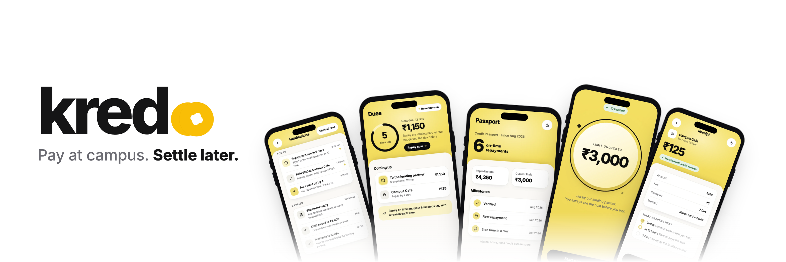

## What is Kredo

Students run out of pocket money long before the month ends, and campus vendors (chai stalls, canteens, xerox shops) mostly run on cash and IOUs. Kredo gives students a small, transparent limit they can spend at those vendors, and gives vendors a reliable way to get paid.

Kredo is the **app and technology partner**. A licensed lending partner (an NBFC) assesses credit and **moves all the money**. Kredo never holds, pools or transfers funds. The lender pays the vendor, and the student repays the lender.

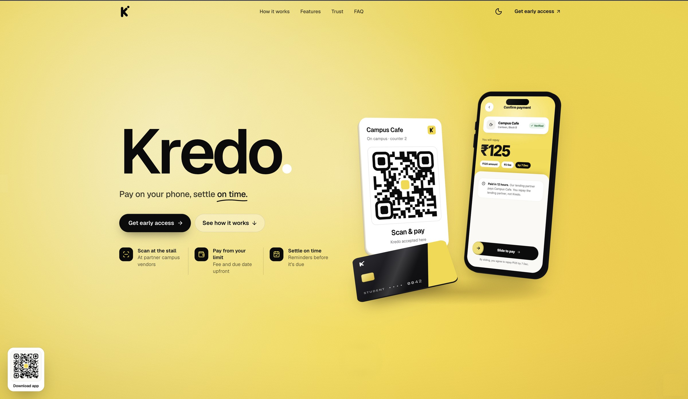

## How it works

| | Step | What happens |
|---|---|---|
| 1 | **Verify** | The student drops in a college ID. The lending partner checks it and sets a starting limit. |
| 2 | **Pay** | At a campus vendor, the student scans the stall QR. The fee, total and due date are shown before they confirm. |
| 3 | **Get paid** | 12 hours after each payment, the lending partner pays the vendor. A payment at 9 am is paid out at 9 pm. |
| 4 | **Repay** | The student repays the lending partner by the due date, with reminders before it. |
| 5 | **Grow** | On-time repayments move the student up a limit ladder. Every change comes with a plain-English reason. |

## Product

### For students

Verify, see what you can spend, pay by QR, track what you owe and when, and repay on time. Costs come before consent, every time.

<table>
  <tr>
    <td align="center">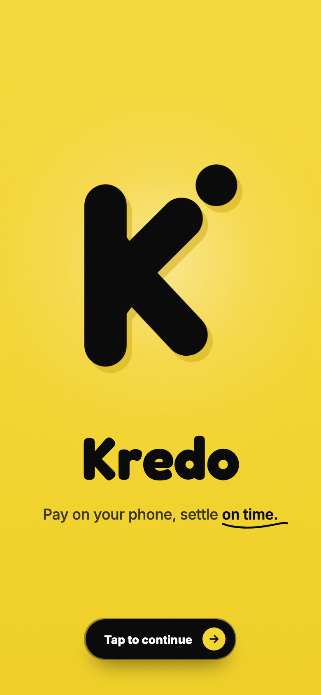 Welcome</td>
    <td align="center">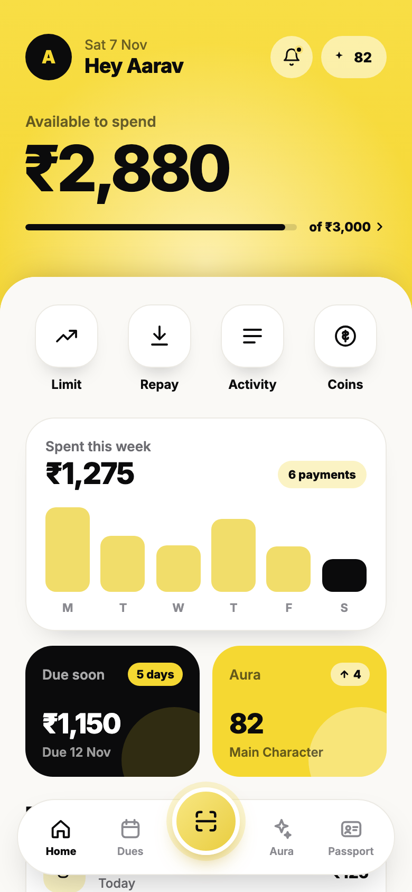 Home</td>
    <td align="center">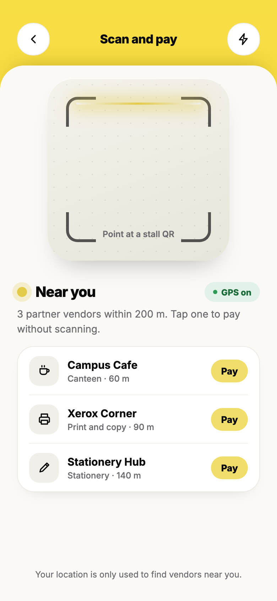 Scan and pay</td>
    <td align="center">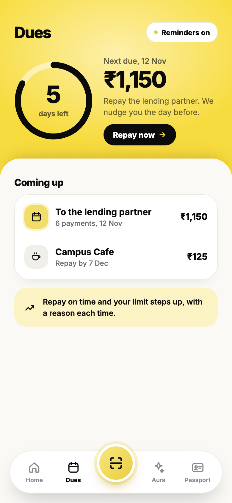 Coins due</td>
  </tr>
  <tr>
    <td align="center">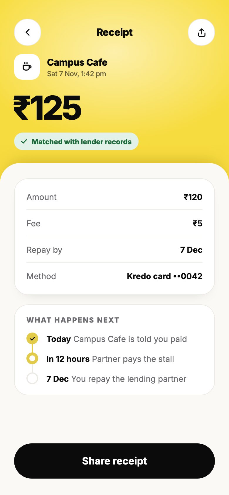 Receipt</td>
    <td align="center">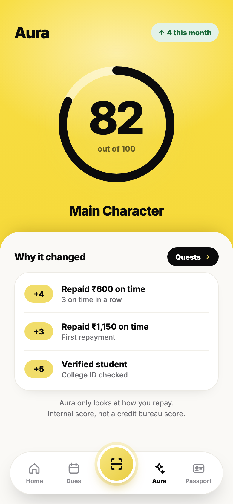 Aura</td>
    <td align="center">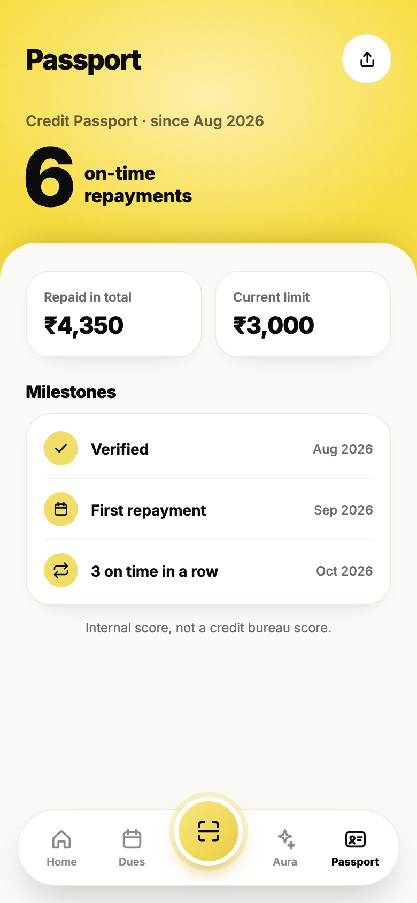 Credit Passport</td>
    <td align="center">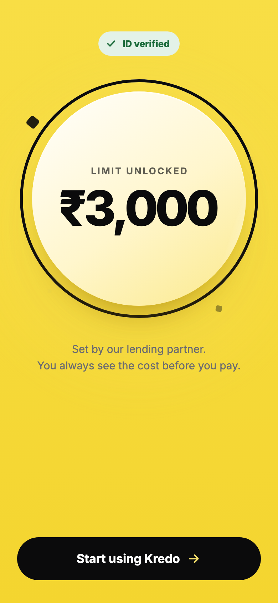 Limit unlocked</td>
  </tr>
</table>

### For vendors

Show a QR, see payments arrive live, and track what is awaiting settlement and what has been paid. Refunds before settlement simply drop the payment out.

<table>
  <tr>
    <td align="center"> Welcome</td>
    <td align="center">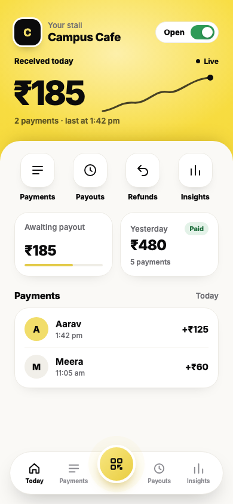 Today</td>
    <td align="center">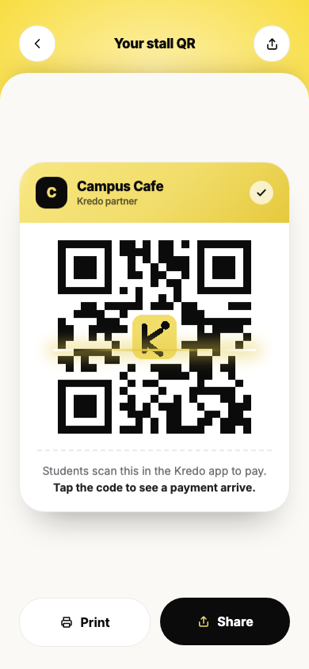 Stall QR</td>
    <td align="center">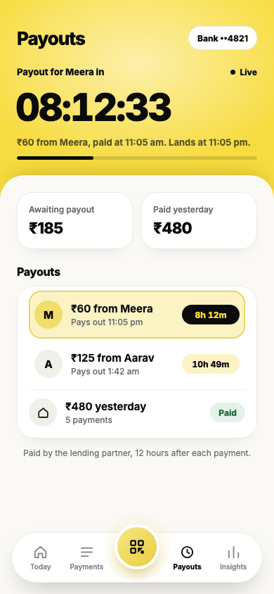 Payouts</td>
  </tr>
</table>

### Aura and the Credit Passport

Aura is the student-facing view of a repayment score. It is one deterministic engine with one number, and every change has a reason a student can read. It never uses college, gender, caste, religion or location. The Credit Passport shows a student's repayment story on one page.

